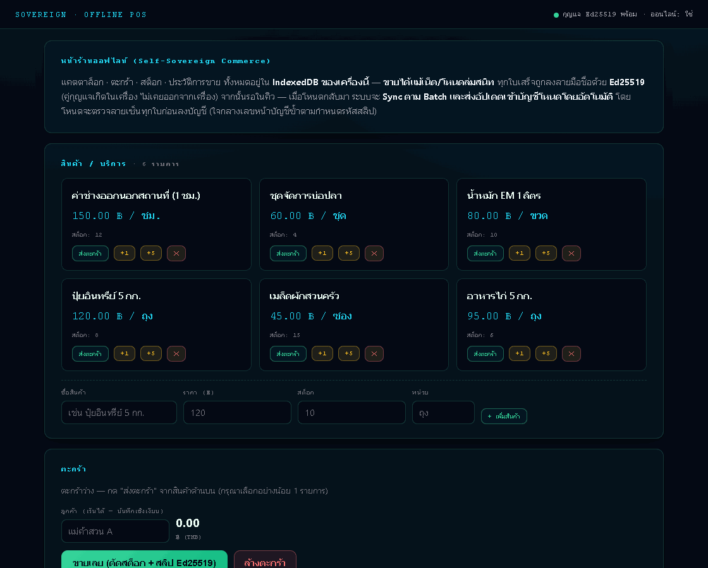
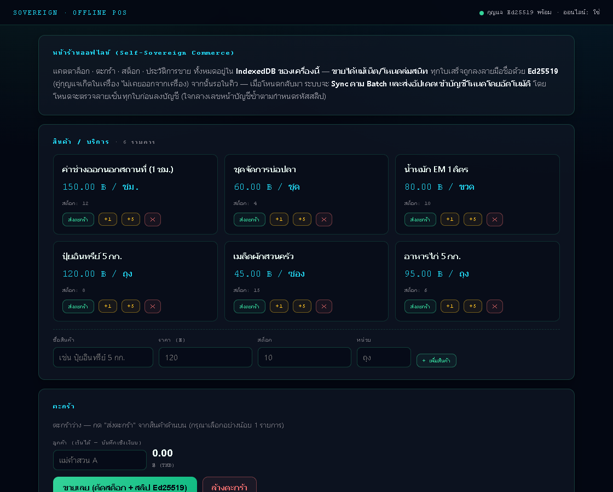
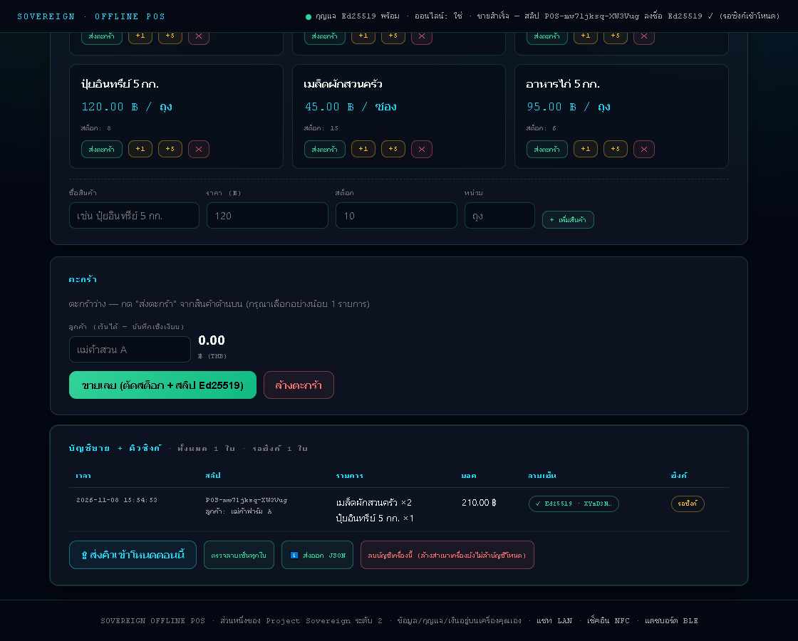
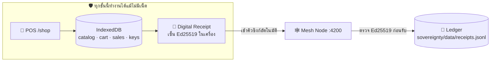
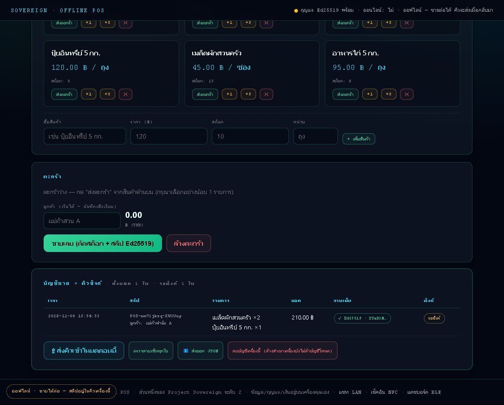

<div align="center">



### 🛡️ Sovereign Offgrid
**OFF-GRID EDGE APPLIANCE OS** — ระบบหลังบ้านที่ใช้เองได้เต็มรูปแบบ **โดยไม่พึ่งอินเทอร์เน็ตแม้แต่วินาทีเดียว**

ขายหน้าร้านออกใบเสร็จลายเซ็นดิจิทัล · คุยระหว่างเครื่องผ่านสัญญาณ LAN · แตะ NFC บันทึกงานฟาร์ม · อ่านค่าเซนเซอร์ Bluetooth · ติดตั้งเป็นแอป PWA บนมือถือ

**เฟรมด้านบนคือการใช้งานจริงจากระบบ:** เพิ่มสินค้าลงตะกร้า → กด **ขายเลย** → ใบเสร็จถูกเซ็นด้วย **Ed25519** ในเบราว์เซอร์ → **ตัดเน็ตแล้วขายต่อได้** (สลิปขึ้นสถานะ `รอซิงก์`) → เน็ตกลับมา สลิปไหลเข้าบัญชีโหนดเอง

[](https://krisakornutama.github.io/sovereign-offgrid/sovereignty/public/shop.html)
[](https://krisakornutama.github.io/sovereign-offgrid/sovereignty/public/lan-messenger.html)
[](https://tools.ietf.org/html/rfc8032)
[](./docker-compose.yml)

</div>

---

## 💎 ทำอะไรได้บ้าง — 5 ระบบครบถ้วน

| ระบบ | ทำอะไร | ลิงก์ LIVE |
|---|---|---|
| 🛒 **Offline POS** | แคตตาล็อก ตะกร้า ตัดสต็อกจริง · ใบเสร็จ**เซ็นด้วยกุญแจ Ed25519 ในเครื่อง** · เน็ตหายก็ขายต่อ สลิปซิงก์เองเมื่อกลับมาออนไลน์ | [เปิดหน้าร้าน](https://krisakornutama.github.io/sovereign-offgrid/sovereignty/public/shop.html) |
| 💬 **LAN Messenger** | แชทระหว่างเครื่องบนสัญญาณ LAN เดียวกัน (UDP broadcast + REST ผ่าน mesh node พอร์ต 4200) — ไม่ใช้เน็ต | [เปิดห้องแชท](https://krisakornutama.github.io/sovereign-offgrid/sovereignty/public/lan-messenger.html) |
| 📡 **NFC Check-in** | แตะแท็ก NFC ผ่านมือถือ (Android Chrome) บันทึกงานฟาร์ม/งานแปลงปลูก ลง IndexedDB ในเครื่อง | [เปิด NFC](https://krisakornutama.github.io/sovereign-offgrid/sovereignty/public/nfc-checkin.html) |
| 📶 **BLE Sensors** | เชื่อมเซนเซอร์ Bluetooth (Xiaomi LYWSD03MMC, ESP32+BME280) อ่านอุณหภูมิ/ความชื้น/แบตเตอรี่ ลง IndexedDB | [เปิดเซนเซอร์](https://krisakornutama.github.io/sovereign-offgrid/sovereignty/public/ble-sensors.html) |
| 📱 **PWA Offline** | Service Worker พรีแคชทุกหน้า + manifest ติดตั้งเป็นแอปบนมือถือ — ใช้ครบฟีเจอร์เมื่อเสิร์ฟจากโหนดของคุณ | [เปิดหน้าร้านเพื่อติดตั้ง](https://krisakornutama.github.io/sovereign-offgrid/sovereignty/public/shop.html) |

> 💡 **ลองใน 30 วินาที:** เปิด POS → กด `+1` หยิบสินค้า 2–3 ชิ้น → ใส่ชื่อลูกค้า → กด **ขายเลย (ตัดสต็อก + สลิป Ed25519)** — ใบเสร็จเกิดในเครื่องคุณทันที ตรวจลายเซ็นย้อนกลับได้ แม้เน็ตหายสลิปจะขึ้น `รอซิงก์` แล้วซิงก์เองเมื่อโหนดกลับมา

> ℹ️ **ข้อจำกัดที่พูดตรง ๆ:** GitHub Pages เป็น static ล้วน — POS ฝั่งเว็บ (แคตตาล็อก/ตะกร้า/เซ็นสลิป) ทำงานครบในเบราว์เซอร์ แต่**แชท LAN และการซิงก์บัญชีต้องรันโหนดเอง** (Docker/Node · ดูด้านล่าง) และ Web NFC รองรับ Android Chrome เท่านั้น (iPhone ยังไม่รองรับ)

---

## 🚀 วิธีเริ่มใช้งาน — เลือกตามความเข้มข้น 3 ระดับ

### 1) เปิดผ่าน GitHub Pages ทันที (ไม่ต้องติดตั้งอะไร)

```
💰 POS:   https://krisakornutama.github.io/sovereign-offgrid/sovereignty/public/shop.html
💬 แชท:   https://krisakornutama.github.io/sovereign-offgrid/sovereignty/public/lan-messenger.html
📡 NFC:   https://krisakornutama.github.io/sovereign-offgrid/sovereignty/public/nfc-checkin.html
📶 BLE:   https://krisakornutama.github.io/sovereign-offgrid/sovereignty/public/ble-sensors.html
```

ลิงก์ทั้งหมดผ่าน HTTPS → เปิดจากมือถือ Android ได้เลย (Web NFC / Web Bluetooth บังคับใช้ [Secure Context](https://developer.mozilla.org/en-US/docs/Web/Security/Secure_Contexts) — HTTPS นี้คือเงื่อนไขที่ปลดล็อกมัน)

### 2) รันด้วย Docker Compose (ครบทุกชั้นในเครื่องคุณ)

```bash
git clone https://github.com/krisakornutama/sovereign-offgrid.git
cd sovereign-offgrid
docker compose up -d
# ✅ POS:      http://localhost:4200/shop
# ✅ แชท LAN:  http://localhost:4200/
# ✅ NFC:      http://localhost:4200/nfc
# ✅ BLE:      http://localhost:4200/ble
```

### 3) รันโหนดเปล่าด้วย Node (ไม่ต้องมี Docker)

```bash
cd sovereignty
node server.js                              # ✨ ไม่ต้อง npm install — ใช้ Node built-ins เท่านั้น

MESH_PASSPHRASE="รหัสลับของคุณ" node server.js   # เสิร์ฟแบบเข้ารหัสเมื่ออยู่บน LAN จริง
```

> เหมาะกับ **Raspberry Pi Zero W (RAM 512 MB ก็วิ่งสบาย)** · Pi 3/4/5 · Android (Termux) · Mini PC — เครื่องไหนมี Node.js ก็ใช้ได้

<div align="center">


</div>

---

## 🏛️ สถาปัตยกรรม — ทำไมจึงต่างจาก POS ธรรมดา



**API ของ mesh node:**

```
GET  /health      → สถานะโหนด · peers · messages · receipts
GET  /peers       → เครื่องเพื่อนบ้านที่ค้นเจอบน LAN
POST /send        → ส่งข้อความลงกลุ่มแชท
GET  /receipts    → อ่านบัญชีการขายทั้งหมดที่ซิงก์เข้ามา
POST /receipts    → รับสลิปจาก POS — ตรวจ Ed25519 ก่อนบันทึก
```

**สิ่งที่ต่างจาก POS ทั่วไป:**

- ✓ **กุญแจ Ed25519 กำเนิดในเบราว์เซอร์ของคุณ** — กุญแจส่วนตัวไม่เคยออกจาก `IndexedDB` และกุญแจสาธารณะถูกฝังในใบเสร็จ ใครถือสลิปก็ตรวจความจริงด้วยตัวเองได้
- ✓ **โหนดไม่เชื่อฝั่ง client** — สลิปที่ยื่นเข้ามาถูกตรวจลายเซ็นอีกครั้งฝั่ง Node ก่อนลงบัญชีเสมอ
- ✓ **Idempotent (ส่งซ้ำได้)** — ระบบ dedupe ตาม `id` ของใบเสร็จ เน็ตหลุดกลางทางแล้วส่งซ้ำก็ไม่เกิดใบสองใบ
- ✓ **ตัดสต็อกแบบ atomic** — สต็อกไม่พอ ระบบยกเลิกทั้งรายการ ไม่มีการบันทึกครึ่ง ๆ กลาง ๆ

<div align="center">

<br><sub><b>โหมดออฟไลน์ (แคปตจากระบบจริง)</b> — ป้ายเตือน "ออฟไลน์ · ขายได้ต่อ — สลิปอยู่ในคิวเครื่องนี้" ขึ้นมาทันทีที่ปิดเน็ต และใบเสร็จใหม่ยังถูกเซ็น Ed25519 ตามปกติ</sub>
</div>

> 🧪 **ทดสอบจริงตอนสร้างระบบ:** ขาย 210฿ → ใบเสร็จเซ็น Ed25519 สำเร็จ → ตรวจลายเซ็นย้อนกลับผ่าน ✓ → ซิงก์เข้าบัญชีโหนด (มี 2 ใบใน ledger)

---

## 🏢 อยู่ตรงไหนในผังระบบ Sovereign — ความสัมพันธ์กับ `sovereign-origin`

`sovereign-offgrid` คือ**แขนออฟไลน์**ของจักรวาล Sovereign — ออกแบบให้ทำงานได้เด็ดขาดด้วยตัวเอง โดยไม่ต้องพึ่งระบบหลักเลย แต่ส่งข้อมูลขึ้นมาให้ระบบหลักใช้ต่อได้

```
                  ╔══════════════════════════════════╗
                  ║      Sovereign Product Line      ║
                  ╚══════════════════════════════════╝

  ┌──────────────────────────┐   ┌─────────────────────────────────┐
  │ 🏠 sovereign-origin      │   │ 🌿 sovereign-offgrid  (repo นี้) │
  │  (Main OS · public)      │   │  OFF-GRID EDGE APPLIANCE OS     │
  │                          │   │                                 │
  │  Desktop app + backend   │◄──┼──  LAN Mesh + Offline POS       │
  │  ขาย · สต็อก · บัญชี ·   │◄──┼──  NFC/BLE + PWA + Ledger       │
  │  ภาษีไทย · ฟาร์ม IoT     │   │  Node.js ล้วน + Docker          │
  │  Next.js + Fastify       │   │  ฟาร์ม/ไร่/ร้านที่ไม่มีเน็ต      │
  └────────────┬─────────────┘   └─────────────────────────────────┘
               │                              │
               └──────   Project Sovereign   ─┴──────
                         (กฤษกรณ์ อุตมะ)
                         [project-sovereign] — เว็บสาธารณะ + โครงการหลัก
```

| โปรเจกต์ | บทบาท |
|---|---|
| 🏠 [`sovereign-origin`](https://github.com/krisakornutama/sovereign-origin) | **ระบบหลัก** — Self-Sovereign Home OS แอป desktop ใช้งานจริง (ขาย สต็อก บัญชี ภาษีไทย ฟาร์ม IoT) |
| 🌿 [`sovereign-offgrid`](https://github.com/krisakornutama/sovereign-offgrid) | **🎉 repo นี้** — เครื่องมือออฟไลน์ระดับพื้นที่ทุรกันดาร ทำงานได้แม้ไม่มี LAN / เน็ต |
| 📡 [`project-sovereign`](https://github.com/krisakornutama/project-sovereign) | เว็บสาธารณะ + โครงการหลังบ้านแบบ self-hosted (เว็บโชว์ + scraper + เว็บผลงาน) |
| 🧠 [`sovereign-rule-engine`](https://github.com/krisakornutama/sovereign-rule-engine) | Rule engine แบบ Peer-to-Peer (Merkle-DAG + CRDT + E2EE) — ใช้อัตโนมัติกรรมร่วมกัน |

**การไหลของข้อมูล `sovereign-offgrid` → `sovereign-origin`:**

- POS ออฟไลน์บน Pi/เครื่องหน้าร้าน บันทึกการขายเป็น **Ed25519 signed receipt** — ข้อมูลชุดนี้อ่านได้ทันทีจาก `GET /receipts` และนำเข้า `sovereign-origin` เป็นข้อมูลบัญชีหลักได้
- ในอนาคต โหนดนี้ทำหน้าที่ **Witness / Archive Node** — ปลายทางตั้งต้นของบัญชีที่จะ push ขึ้น PostgreSQL ของแอป desktop เป็นเอกสารการขาย/บัญชีฉบับจริง

---

## 🔐 ความปลอดภัยตามหลัก Sovereign Design

| หลักการ | การทำงานจริง |
|---|---|
| 🧾 **ออฟไลน์ก่อน** | ขาย / แชท / แตะ NFC / อ่าน BLE ได้โดยไม่ต้องมีเน็ตแม้แต่วินาทีเดียว |
| 🔏 **ข้อมูลอยู่ในเครื่อง** | กุญแจ Ed25519 กำเนิดในเบราว์เซอร์และไม่เคยออกจาก IndexedDB ของเครื่อง |
| ✂️ **Zero Trust** | โหนดตรวจลายเซ็นก่อนรับสลิป — ข้อมูลปลอมถูกปฏิเสธ `400` ทุกครั้ง (ทดสอบแล้ว) |
| 📥 **Idempotent** | dedupe ตาม `id` ใบเสร็จ — ส่งซ้ำบัญชีไม่เกิดรายการซ้ำ |
| 🔐 **E2EE เลือกได้** | ตั้ง `MESH_PASSPHRASE` → เข้ารหัสข้อความ/เพย์โหลดทุกชิ้นด้วย AES-256-GCM |
| 🐳 **คอนเทนเนอร์ปลอดภัย** | Docker รัน non-root + read-only filesystem ตามคู่มือ [`DOCKER.md`](DOCKER.md) |

---

## 📖 เอกสารฉบับเต็ม

- [`sovereignty/README-MESH.md`](sovereignty/README-MESH.md) — สถาปัตยกรรม LAN mesh + Offline POS แบบละเอียด (พร้อมผลทดสอบจริงทุกข้อ)
- [`DOCKER.md`](DOCKER.md) — คู่มือ deploy แบบ Docker (Dockerfile non-root + read-only)
- [`WORK-STATUS.md`](WORK-STATUS.md) — สถานะงานฉบับวิศวกร จะหยิบทำต่อได้ทันที
- [`FULL-QUALITY.md`](FULL-QUALITY.md) — รายงานการตรวจคุณภาพของรอบสร้างนี้
- 📗 [`docs/images/pos-demo.gif`](docs/images/pos-demo.gif) — GIF สาธิตขายจริง + [`pos-signing.png`](docs/images/pos-signing.png) ใบเสร็จ Ed25519 + [`pos-offline.png`](docs/images/pos-offline.png) โหมดออฟไลน์
- [`docs/README-PORTFOLIO.md`](docs/README-PORTFOLIO.md) — เอกสารเดิมของเว็บโชว์ผลงาน static ที่รวมอยู่ในโครง root ของ repo นี้

> 🗒 root ของ repo นี้ยังเสิร์ฟ**เว็บโชว์ผลงาน static** (`index.html`, `projects.html`, `farm.html`, …) คู่กันได้ — ส่วน OS ออฟไลน์ทั้งหมดอยู่ในโฟลเดอร์ [`sovereignty/`](sovereignty/)

---

## 👤 ผู้พัฒนา

**กฤษกรณ์ อุตมะ (Krisakorn Utama)** — System Architect
> ออกแบบและปล่อยระบบ Electron / Next.js + Node.js เองทั้งชุด — ข้อมูลทุกชุดรออยู่ในเครื่องของคุณเอง ตามหลัก sovereignty
> แผนการพัฒนาทั้งหมดดูได้ที่ [project-sovereign](https://github.com/krisakornutama/project-sovereign)

---

<div align="center">

**⭐ ถ้าระบบนี้ช่วยงานคุณได้ กด Star เป็นกำลังใจให้การพัฒนาด้วย 🫶**

</div>
